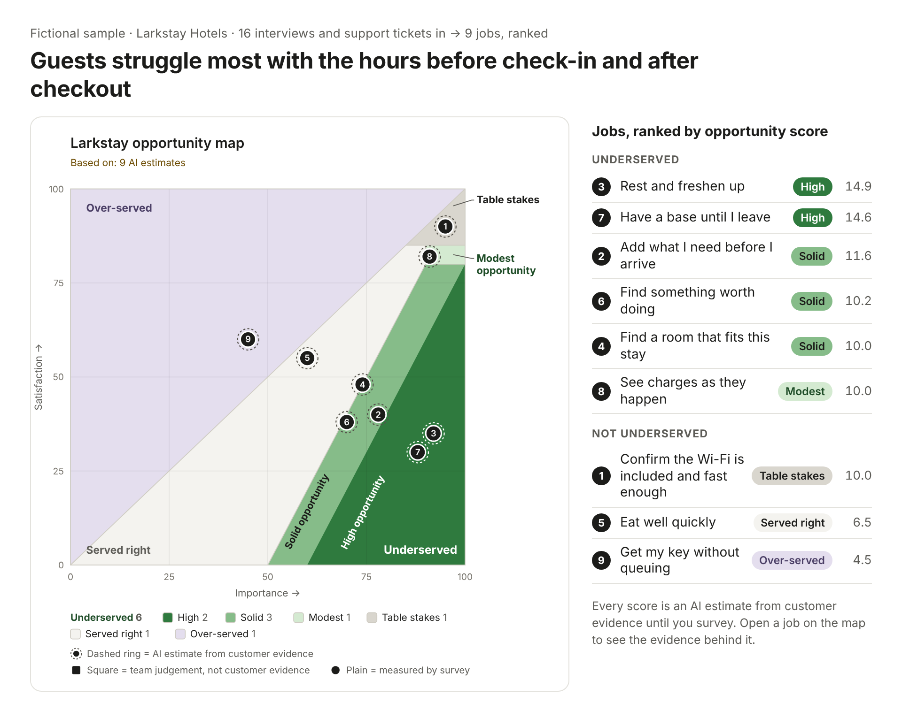
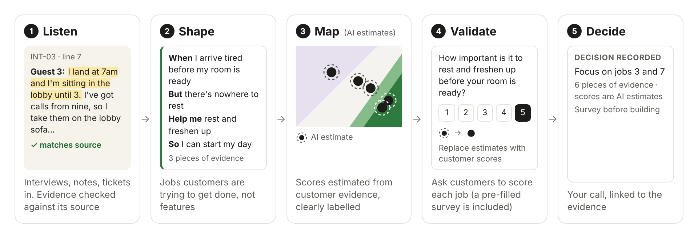

# Turn customer research into an opportunity map

A Claude agent workflow that helps you understand what customers are trying to accomplish, identify underserved needs, and decide where to focus.

<picture>
  <source media="(prefers-color-scheme: dark)" srcset="docs/images/hero-dark.png">
  
</picture>

Great products start with understanding people deeply. As Clayton Christensen put it, we “hire” products to help us get a job done.

But understanding customers is only the beginning. You still need to decide which needs to address first.

I built the JTBD Opportunity Landscape agent to help with that decision: create an initial opportunity map from your research, then refine it with new interviews and customer ratings.

The workflow draws on Jobs to Be Done and adapts Tony Ulwick’s Outcome-Driven Innovation (ODI) opportunity landscape and scoring algorithm. It turns customer research into a reviewable job list and an opportunity map, with supporting evidence and a visible basis for each score.

This is an adaptation, not a full ODI implementation: it scores customer jobs and can start with clearly labelled AI estimates before you collect customer ratings.

Next time you have some customer research and priorities are unclear, start with what you have: a few interview notes, support tickets, customer quotes or an existing job list.

Run `/jtbd` in Claude, add your research, and use the first map to see where the evidence is strong, where the agent made assumptions, and what to validate next.

## How it works

Claude starts with two questions:

- What do you want to learn about your customers?
- What decision will this inform?

Those answers frame the work. The workflow then moves through five stages:

**Listen → Shape → Map (AI estimates) → Validate → Decide**

<picture>
  <source media="(prefers-color-scheme: dark)" srcset="docs/images/stages-dark.png">
  
</picture>

1. **Listen.** Drop in your interviews, support tickets, or notes. It extracts customer evidence and checks the extracted text against the original sources.
2. **Shape.** It turns the extracted evidence into jobs that describe what customers are trying to accomplish—not features you could build. You review the framing and confirm the job list.
3. **Map (AI estimates).** Where customer ratings are missing, the agent estimates how much each job matters and how well it is served today, then plots those scores on the opportunity map, labelled as AI estimates.
4. **Validate.** Use the pre-filled survey to collect customer ratings and replace estimated scores.
5. **Decide.** You choose where to focus. Decisions recorded in the workflow link back to supporting quotes, and changes to job scores are logged.

## What you get

An editable opportunity map. Open a job to see its supporting evidence.

Export the scores and evidence, and use the pre-filled survey to replace estimates with ratings from your customers.

Each score is labelled as an initial AI estimate, an AI estimate revised using customer evidence, your judgement, or a survey result. The ranking informs your decision; it doesn’t make it for you.

## Quick start

**Claude app — desktop or web**

1. Open **Customize → Plugins → + Add**.
2. Add the marketplace `bijoycherian/jtbd-skills`.
3. Click **Add** on **Jtbd skills**, or select **Try in chat** to try it first.
4. Start a new chat and type `/jtbd`.
5. Attach your research—transcripts, tickets, or notes—and say what you want to learn and what decision it will inform. Using real customer data? Read [Data and privacy](#data-and-privacy) first.


**Claude Code**

```bash
claude plugin marketplace add bijoycherian/jtbd-skills
claude plugin install jtbd-skills@jtbd-research-skills
```

Then type `/jtbd` and attach your research. The full command is `/jtbd-skills:jtbd`.

**No research handy?** Download [`larkstay-starter-kit.zip`](https://github.com/bijoycherian/jtbd-skills/releases/latest/download/larkstay-starter-kit.zip) from the latest release: a fictional hotel study, its job list and four things to try. The same files are in [`examples/larkstay/`](examples/larkstay/).

## What I’m exploring next

- **Research connectors:** bring evidence in from tools such as Granola, Zoom and Dovetail via MCP.
- **Jobs by customer group:** compare which jobs matter most to each group.
- **Audio and video input:** start with recordings rather than uploading transcripts.
- **Web app:** a shared workspace to save your research, jobs and opportunity maps, review evidence together, and refine priorities as new evidence comes in.
- **Agent-assisted interviews:** explore how an agent could reconstruct the circumstances behind a customer’s decision—what prompted them to act, what they tried, and what progress they wanted to make.

Try it with the research you already have. I’d love to hear where the job list or ranking didn’t match your reading of the evidence. [Open an issue](../../issues/new) with an example.

## FAQs

**What do I need to get started?**
*Start with interview notes, support tickets, customer quotes or an existing job list. Tell the agent what you want to learn and which decision the research should inform.*

**What will I get?**
*A reviewable job list and an editable opportunity map, with supporting evidence and a visible basis for each score. You can export the scores and evidence and use a pre-filled survey to collect customer ratings.*

**Can I use the map before collecting customer ratings?**
*Yes—as a starting point for review, not as measured customer priorities. Scores based on AI estimates are labelled. Inspect the evidence and assumptions, then collect customer ratings to replace the estimates.*

**Is this a full Outcome-Driven Innovation implementation?**
*No. It adapts the opportunity landscape and scoring approach to customer jobs rather than implementing the full ODI method.*

## Data and privacy

- Your research goes to whichever AI tool runs the workflow. Check your company's rules on which tools may receive customer transcripts and tickets.
- Anonymise your research before attaching it (User 1, Company A). Before reading further, it checks every source for names, emails, phone numbers and account IDs, and pauses on any it finds. It catches most names, but not every one, so don't rely on it alone.
- There is no telemetry. The optional run report carries counts only, never customer content.
- This repo contains only a fictional sample study (Larkstay Hotels).

## Status and limits

**v1.0.1.** The automated checks pass on every change, and the full flow has been run by hand in the Claude app. Results are in [EVALS.md](EVALS.md).

- **Study size:** about 75,000 words (7–8 hour-long interviews plus ~100 tickets) are read in one go; larger studies are read in batches and haven't been fully tested.
- **Needs** Python 3.9+, plus openpyxl and matplotlib for the spreadsheet and chart. Without them you still get the map, and the run says what's missing.

## Method

Scores follow the opportunity algorithm: score = importance/10 + max(importance − satisfaction, 0)/10, on a 0–20 scale, where both are the share of customers rating 4–5. High, Solid and Modest opportunity together are Underserved.

## Feedback

Found a bug, or something confusing? Please [open an issue](../../issues/new). Pull requests aren't being accepted yet.

To share how a run went, open **Export → Copy run report** on the map page and paste it into a [run-report issue](../../issues/new?template=run-report.yml). It carries counts only, never your customer content.

## Licence

MIT. See [LICENSE](LICENSE).

*This is an independent project, not affiliated with or endorsed by Strategyn. Outcome-Driven Innovation is a trademark of Strategyn.*
