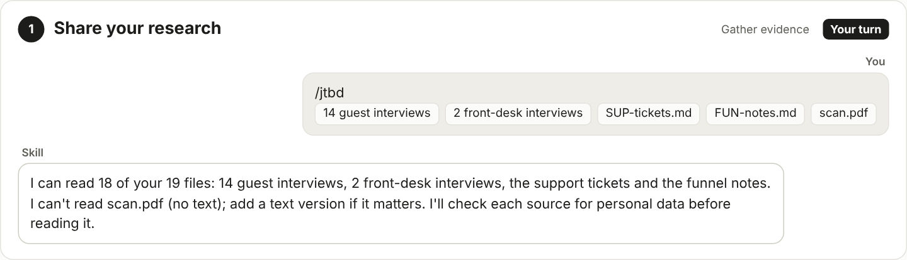
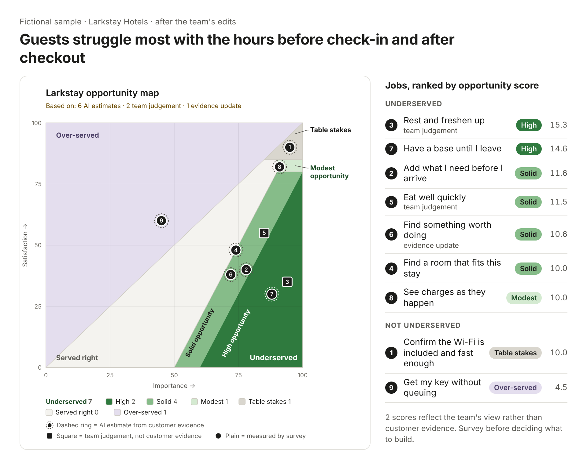

# How /jtbd works: an example run

A fictional study (Larkstay Hotels). Variants show what happens in less common situations.

## 0. Where your customers struggle most · Preview

**Listen** → **Shape** → **Map (AI estimates)** → **Validate** → **Decide**

*Fast estimates from real customer words first; measured when it matters. An interactive opportunity map of the jobs your customers are trying to get done: how much each matters and how well it's served today, every point backed by what customers actually said.*

## 1. Share your research · Your turn

**You:** /jtbd  
*Attached:* 14 guest interviews, 2 front-desk interviews, SUP-tickets.md, FUN-notes.md, scan.pdf

**Skill:** I can read 18 of your 19 files: 14 guest interviews, 2 front-desk interviews, the support tickets and the funnel notes. I can't read scan.pdf (no text); add a text version if it matters. I'll check each source for personal data before reading it.

## 2. Answer two questions · Your turn

**Skill:** Two quick questions before I start:  
1. What do you want to learn about your customers? For example: “Where do guests struggle to make their stay fit around their travel plans?”  
2. Is there a decision this should inform? (optional) For example: “Where should Guest Revenue focus in 2027?”  
  
Then I'll read everything and check back with you twice: once on the framing, once on the job list.

**You:** 1. Where do guests struggle to make their stay fit around their travel plans?  
2. Where Guest Revenue should focus in 2027

## 2a. If your question names a product (variant) · Your turn

**You:** Which guest revenue product should we fund in Q1 2027?

**Skill:** Your question is about our products, so it may steer the study towards what we already sell. I suggest running it on a question about guests instead:  
“Where do guests struggle to make their stay fit around their travel plans?”  
Your product question isn't lost: I'll answer it at the end.  
  
Reply with one of:  
• yes (recommended): use the suggested question  
• your own wording: I'll use that instead  
• keep mine: use your original question (the results will note that they focus on your products)

**You:** yes

## 3. Sit back while it reads · Nothing to do

**Skill:** Reading your 18 sources in one go. No private details found.

**Skill:** Done. I pulled out 22 quotes and checked each one against its source. One interview (Front desk 5) had nothing relevant, so it won't shape the results.

## 3a. If a file contains a real name (variant) · Your turn

**Skill:** I've paused before reading further. Interview 6, line 14 contains what looks like a real name. Replace it with a pseudonym such as Guest 6 and re-attach the file. I'll continue from there.

**You:**   
*Attached:* guest-interview-06.txt

**Skill:** Thanks, Interview 6 is clear. Carrying on.

## 3b. If the study is large (variant) · Your turn

**You:** /jtbd  
*Attached:* 62 interviews, support-tickets.csv

**Skill:** This study is about 300k words across 63 sources, so I'll read it in batches and show progress as each one finishes; it will take longer than a small study. Studies this large haven't been fully tested yet, so splitting it into two will give more reliable results.  
  
Shall I start? You can also remove some sources first.

**You:** Start

## 4. Check the framing · Your turn

**Skill:** Here's how I'd frame the study.  
Main goal: Make my stay fit around my travel plans (22 quotes).  
Who: business travellers (7 quotes), all guests (6), leisure guests (4; few quotes, so treat with care). Front desk staff (3) and booking data (2) add context.  
When: booking, before arrival, arrival, the stay, departure.  
Reply 'ok', or tell me what to change, for example: 'split business travellers by trip length'.

**You:** ok

## 5. Check the job list · Your turn

**Skill:** 11 draft jobs (D1 to D11), by stage.  
Arrival  
 D3. Rest and freshen up before my room is ready  
 D4. Find a room that fits this stay  
 D5. Compare room options quickly  
Departure  
 D7. Have a base until I leave  
…  
Reply 'ok', or for example 'merge D4 and D5', 'drop D9'.

**You:** merge D4 and D5, drop D9

**Skill:** Done: 9 jobs, numbered 1 to 9 on your map. D4 and D5 are now one (“Find a room that fits this stay”), and D9 is gone. Scoring now.

## 6. See your first map (AI estimates) · Nothing to do

**Skill:** Underserved: 6 of 9 jobs. The biggest gap is the hours before check-in and after checkout.  
  
For the decision (where Guest Revenue should focus in 2027): start with the hours around the stay (jobs 3 and 7). Guests already pay for an extra night to keep a room, so the need is real and worth money.  
  
All scores are AI estimates: good for choosing what to survey. Run the survey before deciding what to build.  
*Attached:* larkstay_map.html, larkstay_scores.xlsx, larkstay_map.png, readout.md

*Image:* The map page: 9 jobs on importance and satisfaction, each with a dashed ring (AI estimate); 6 in the Underserved zones.

## 7. Make it yours · Optional

*Image:* Job 5 open on the page: importance changed from 60 to 85, tagged “Your judgement · AI estimate was I 60, S 55”, with the reason and a History entry.

*Open a job to see the quotes behind it. Change a number or drag the marker, then say why. When you're done, export the jobs file and attach or paste it in chat.*

**You:**   
*Attached:* jobs.csv (edited)

**Skill:** Applied your edits to 1 job. Job 5 moved from Served right to Solid opportunity (importance 60 to 85; your reason: front desk sees this every morning). The updated page and summary are attached.

## 7a. Ask about a score (variant) · Optional

**You:** Why is “rest and freshen up” at 92 importance?

**Skill:** 11 business travellers raised it, and the front desk sees it every morning (E-012, E-066, E-088). No one said it didn't matter. It would drop if leisure guests rarely arrive early; only 2 of them mention it.

**You:** Our leisure guests arrive early too, on weekend flights.

**Skill:** None of the interviews say that, so I can't raise it from the evidence. I can record it as your judgement, with your reason (“weekend flights arrive early”). It'll show as your judgement on the page, not as evidence. Do that?

**You:** yes

## 8. Check with customers · Optional, weeks later

**You:** Write the survey questions

**Skill:** Here's the survey template with your 9 jobs already filled in. The Questionnaire sheet has every question ready to copy into your survey tool. Aim for at least 200 answers; the survey guide explains how. When the results are in, start a new chat with /jtbd and attach the completed template with your jobs file, so every job keeps its quotes.  
*Attached:* jtbd-survey.xlsx (your 9 jobs filled in)

**You:** /jtbd  
*Attached:* jobs.csv, jtbd-survey.xlsx (completed)

**Skill:** I've got your 9 jobs and 204 answers (4 failed the attention check, so 200 count). Estimates replaced with measured scores. “Rest and freshen up” is High for business travellers but only Solid for leisure guests. “Find something worth doing” could change zone within the margin of error; worth a closer look.

## 9. Decide, and run it again · Your turn

**You:** We'll focus Guest Revenue in 2027 on jobs 3 and 7, starting with early check-in, because guests already pay for an extra night to keep a room.

**Skill:** Recorded the decision: focus Guest Revenue in 2027 on the hours around the stay, starting with early check-in. It rests on jobs 3 and 7, backed by 6 quotes (E-012, E-066, E-088, E-077…). Based on: 1 AI estimate · 1 team judgement. The survey would confirm it.

*Share the image or the summary with your team. It shows what each score is based on, so everyone knows what's measured and what's judgement. Keep the jobs file: next time, attach it with your new research and the study starts from these jobs.*
